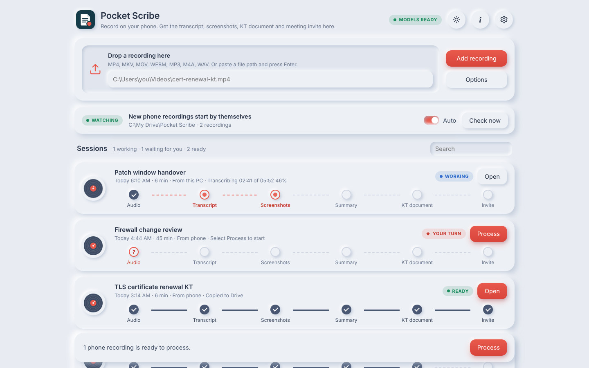
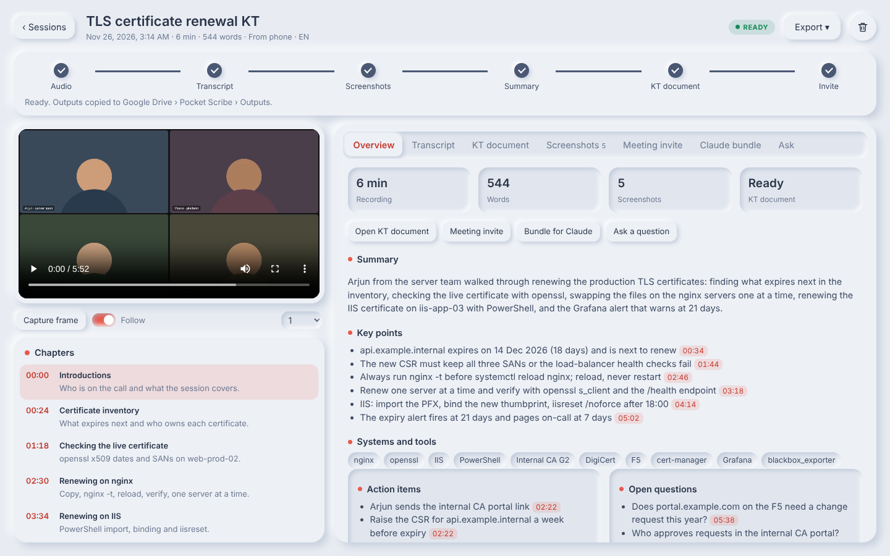
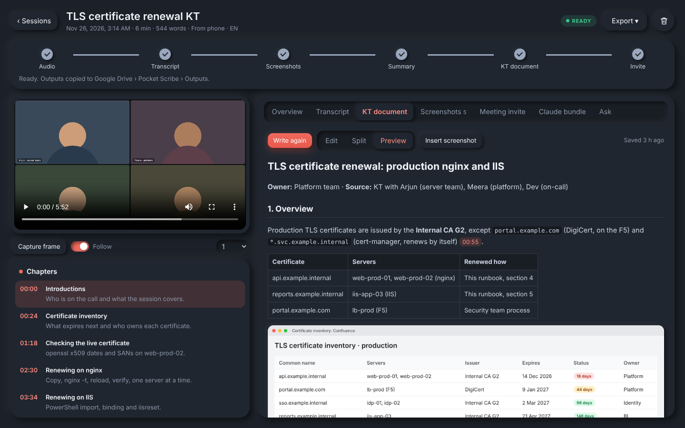
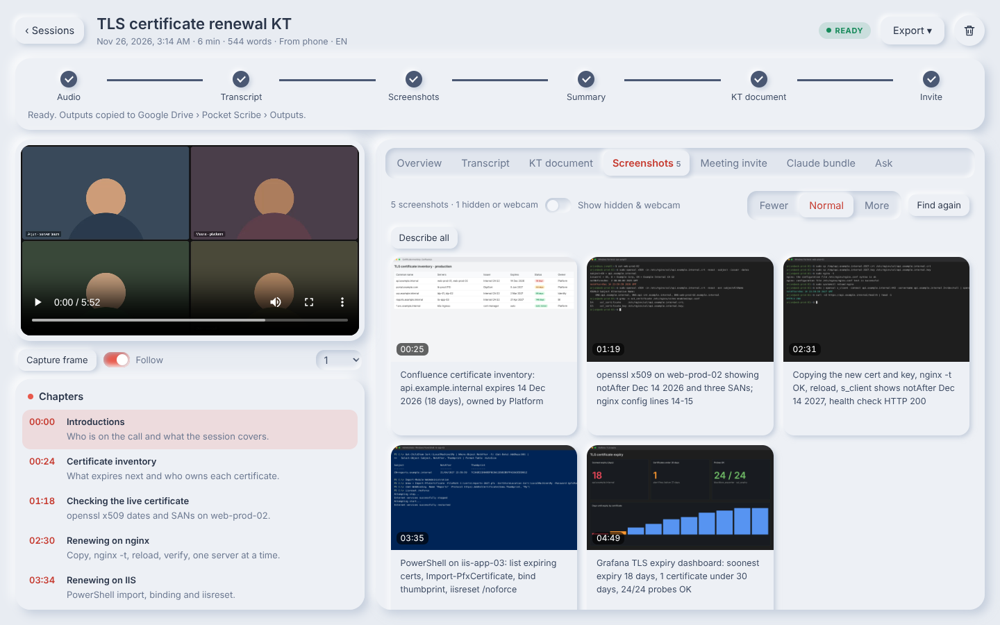
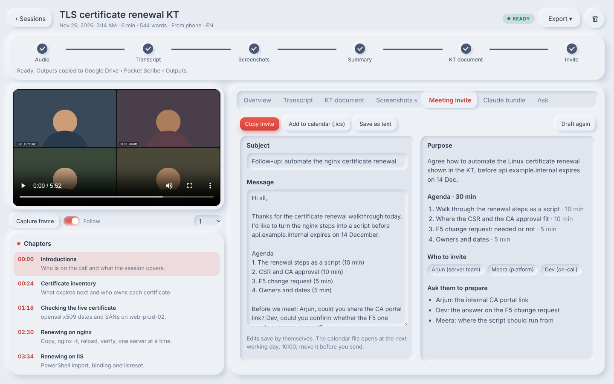
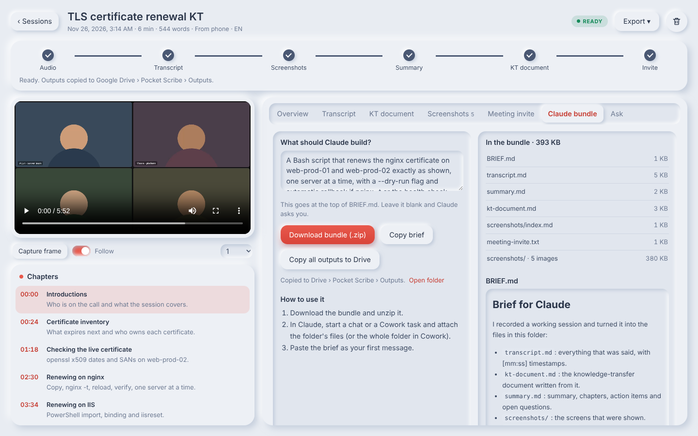
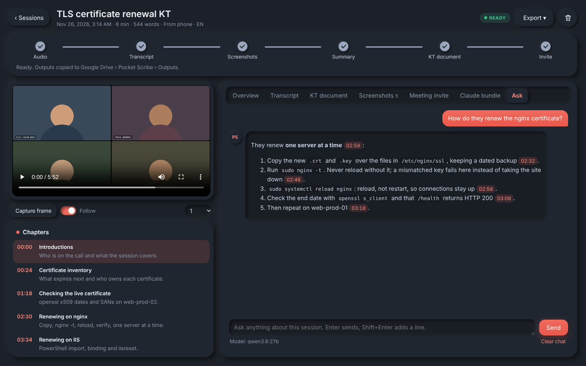
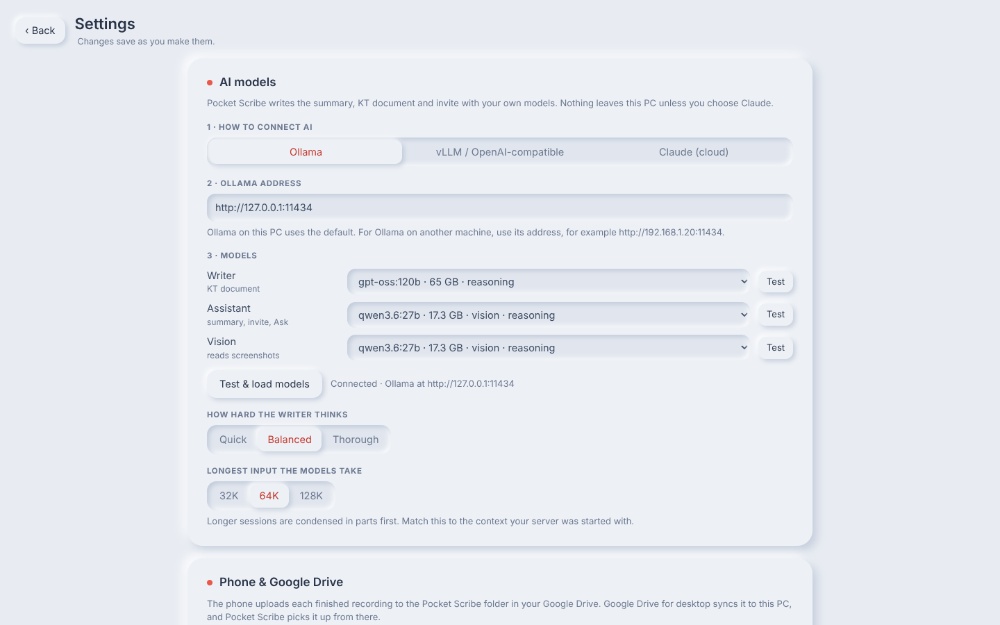
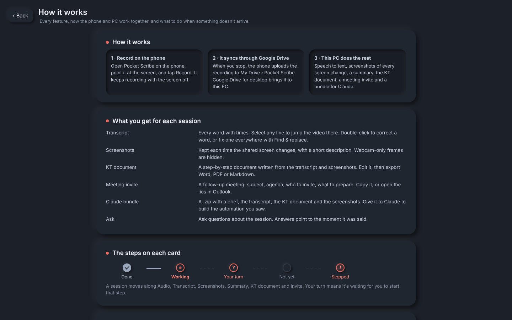

<p align="center">
  
</p>

<h1 align="center">Pocket Scribe</h1>

<p align="center">
  Record a KT call or meeting on an old Android phone.<br>
  Get the transcript, screenshots, KT document, meeting invite and a bundle for Claude on your Windows PC, with your own local models.
</p>

<p align="center">
  <a href="docs/INSTALL.md"><b>Install</b></a> ·
  <a href="docs/user-guide.md"><b>User guide</b></a> ·
  <a href="docs/COWORK-INSTALL-PROMPT.md"><b>Install with Claude Cowork</b></a> ·
  <a href="CHANGELOG.md"><b>What's new</b></a>
</p>

<picture>
  <source media="(prefers-color-scheme: dark)" srcset="docs/images/main-dark.png">
  
</picture>

## What it does

You sit in a call where someone shares their screen and walks you through a job, such as renewing TLS certificates. The phone records it. The PC turns it into everything you need afterwards.

| | Phone: **Pocket Scribe** | PC: **Pocket Scribe Desktop** |
|---|---|---|
| **Job** | Records audio, or audio and video, with the screen off | Turns the recording into outputs |
| **Hands off by** | Uploading to the **Pocket Scribe** folder in Google Drive | Picking it up from Google Drive for desktop by itself |
| **You get** | A named recording, kept until Drive confirms it | Transcript, screenshots, summary, KT document, meeting invite, Claude bundle and Q&A |
| **Runs on** | Android 8 or later | Windows 10 or 11, models on **Ollama**, **vLLM** or (optional) **Claude** |

## Highlights

- **One clean page.** Every session is a card with a six-step rail: Audio, Transcript, Screenshots, Summary, KT document, Invite. Light and dark mode, soft animations, an **i** button that explains everything and a full **Settings** page.
- **Hands-free from the phone.** Name the recording on the phone, and the PC starts processing as soon as Drive syncs it. Finished outputs are copied back to **Pocket Scribe › Outputs** in Drive so you can open them anywhere.
- **Screenshots that matter.** A frame is kept each time the shared screen changes, then described by a vision model. Webcam-only frames are hidden.
- **A KT document you can edit.** Written step by step from the transcript and screenshots, with `[mm:ss]` links back to the video. Export Word, PDF or Markdown.
- **A meeting invite.** Subject, agenda, attendees and prep for the follow-up, as text or an `.ics` for Outlook.
- **A bundle for Claude.** One zip with a brief, the transcript, the KT document and the screenshots, ready to give Claude to build the automation you just watched.
- **Your models, your PC.** Ollama or any OpenAI-compatible server such as vLLM. Claude is there if you want it, with the key stored encrypted on the PC.

## Screens

| Session overview | KT document |
|---|---|
|  |  |
| **Screenshots** | **Meeting invite** |
|  |  |
| **Claude bundle** | **Ask** |
|  |  |
| **Settings** | **How it works (i)** |
|  |  |

More screens, in both themes, are in the [user guide](docs/user-guide.md).

## Install in three steps

1. **Get a model server.** Install [Ollama for Windows](https://docs.ollama.com/windows) and pull a writer and an assistant model, for example `ollama pull gpt-oss:120b` and `ollama pull qwen3.6:27b`. A vLLM server works too.
2. **Install the desktop app.** Download this repository to a folder you'll keep, for example `C:\Users\you\Pocket Scribe`, and double-click **`Setup Pocket Scribe Desktop.bat`**. It takes 5 to 10 minutes the first time and puts a **Pocket Scribe Desktop** icon on your Desktop.
3. **Connect the phone.** Build and install the Android app, connect Google Drive in its Settings, and sign in to the same account in Google Drive for desktop on the PC.

The [install guide](docs/INSTALL.md) has every step, including the one-time Google setup. To have Claude Cowork do the PC part for you, paste the [Cowork install prompt](docs/COWORK-INSTALL-PROMPT.md).

## How it works

```
Phone                        Google Drive                     PC
─────                        ────────────                     ──
record ─► name & save ─────► My Drive › Pocket Scribe ──────► Pocket Scribe Desktop
                             (mp4/m4a + details .json)        │
                                                              ├─ ffmpeg ─► Whisper ─► transcript
                                                              ├─ screen-change detection ─► screenshots ─► vision model
                                                              ├─ assistant model ─► summary, chapters, invite, Ask
                                                              ├─ writer model ─► KT document
                                                              └─ zip ─► Claude bundle
                             My Drive › Pocket Scribe ◄───────┘ copies KT document, invite and bundle
                             › Outputs
```

| Step | Runs where | Model |
|---|---|---|
| Speech to text | Your PC | Whisper large-v3-turbo (faster-whisper on CPU, or whisper.cpp on GPU) |
| Screenshot descriptions | Your model server | **Vision** model, for example `qwen3.6:27b` |
| Summary, chapters, invite, Ask | Your model server | **Assistant** model, for example `qwen3.6:27b` |
| KT document | Your model server | **Writer** model, for example `gpt-oss:120b` |

Models are picked for you on first launch. You can change any of them in **Settings › AI models**.

## Privacy

The desktop app listens only on `127.0.0.1`. Recordings, transcripts and outputs stay in the app's `data` folder and in your own Google Drive. Nothing goes to a cloud model unless you choose **Claude** in Settings. API keys are encrypted with Windows (DPAPI) and never shown again after you save them. The phone uses the `drive.file` scope, so it can only see files it created.

## Repository layout

| Path | What it is |
|---|---|
| `app/`, `static/`, `run.py`, `launcher.py` | Pocket Scribe Desktop (FastAPI server and the single-page app) |
| `Setup Pocket Scribe Desktop.bat`, `scripts/` | One-time Windows setup and shortcuts |
| `pocket-scribe/` | Pocket Scribe for Android (Kotlin) |
| `docs/` | Install guide, user guide, Cowork prompt and screenshots |
| `tests/` | Desktop tests (`python -m pytest -q tests`) |

## Help

- [Troubleshooting](docs/user-guide.md#troubleshooting)
- [What's new](CHANGELOG.md)
