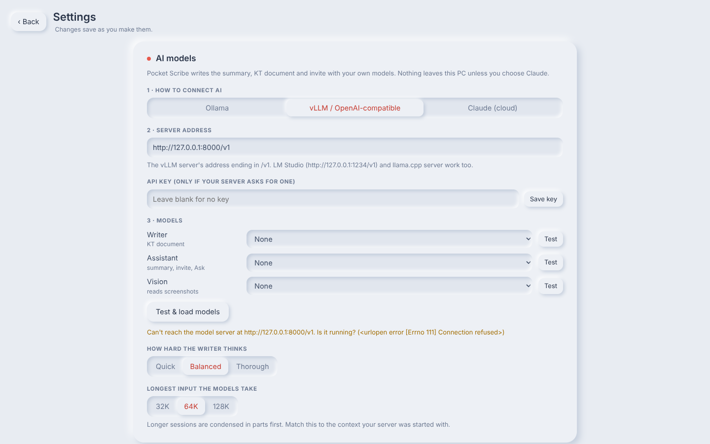
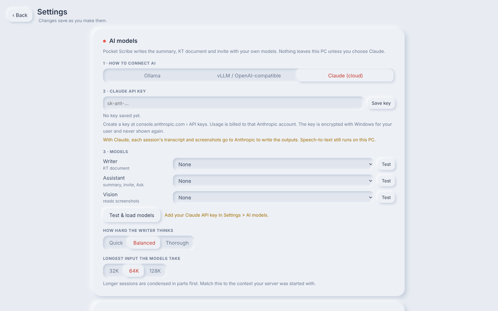
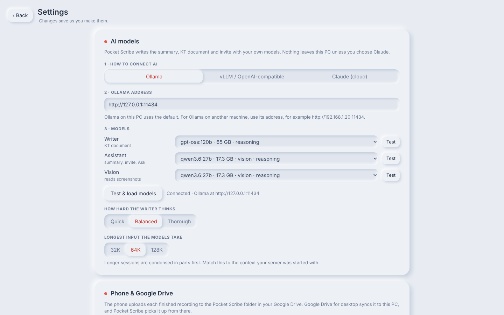

# Install Pocket Scribe

This sets up both apps: **Pocket Scribe Desktop** on your Windows PC and **Pocket Scribe** on your Android phone. Google Drive carries recordings from the phone to the PC.

Plan about 30 minutes the first time. Most of it is downloads.

- [What you need](#what-you-need)
- [1. Set up a model server](#1-set-up-a-model-server)
- [2. Install Pocket Scribe Desktop](#2-install-pocket-scribe-desktop)
- [3. First run and Settings](#3-first-run-and-settings)
- [4. Google Drive on the PC](#4-google-drive-on-the-pc)
- [5. Pocket Scribe on the phone](#5-pocket-scribe-on-the-phone)
- [6. Check it end to end](#6-check-it-end-to-end)
- [Update, move or remove](#update-move-or-remove)

> Prefer to have Claude do the PC part? Paste the [Cowork install prompt](COWORK-INSTALL-PROMPT.md) into Claude Cowork on the PC. It checks first, asks before it installs anything, and verifies the result.

## What you need

| | Minimum | Notes |
|---|---|---|
| PC | Windows 10 or 11, 64-bit | 16 GB RAM to run the app. Models need more, see below |
| Disk | About 6 GB free | Python, packages, Whisper model (1.6 GB) and your sessions |
| Model server | Ollama, vLLM or another OpenAI-compatible server | Can be on this PC or another machine on your network |
| Phone | Android 8 or later | An old phone is fine. Camera for screen capture, or audio only |
| Google | One Google account | Same account on the phone and in Google Drive for desktop |
| Internet | For setup only | Day-to-day processing is local, apart from Drive sync |

Python is installed for you if it's missing.

## 1. Set up a model server

Pocket Scribe Desktop needs a model server to write the summary, KT document and invite. Speech to text runs inside the app and needs no server.

### Ollama (simplest)

1. Install [Ollama for Windows](https://docs.ollama.com/windows) and start it.
2. Pull a **writer** and an **assistant** model. Pick sizes that fit your memory:

   | Your GPU or unified memory | Writer (KT document) | Assistant and vision |
   |---|---|---|
   | 96 GB or more | `gpt-oss:120b` | `qwen3.6:27b` |
   | 24 to 48 GB | `gpt-oss:20b` | `qwen3.6:27b` or `gemma3:12b` |
   | 12 to 16 GB | `gemma3:12b` | `gemma3:12b` |

   ```powershell
   ollama pull gpt-oss:120b
   ollama pull qwen3.6:27b
   ```

3. Check it answers: `ollama list` shows both models.

The assistant model also describes screenshots, so pick one with **vision** if you want descriptions. Settings shows which models can see.

### vLLM or another OpenAI-compatible server

Start the server with an OpenAI-compatible endpoint, for example `http://192.168.1.20:8000/v1`. In step 3 you choose **vLLM / OpenAI-compatible** and paste that address. Add an API key only if your server asks for one.



### Claude (optional, cloud)

If you choose **Claude (cloud)** in Settings, the transcript and screenshots for the steps you run are sent to Anthropic. Paste an API key from the Anthropic Console. The key is encrypted with Windows and never shown again.



## 2. Install Pocket Scribe Desktop

1. Download this repository. Either:
   - **Code › Download ZIP** on [the GitHub page](https://github.com/nikhilgs817/pocket-scribe), then extract it, or
   - `git clone https://github.com/nikhilgs817/pocket-scribe.git "%USERPROFILE%\Pocket Scribe"`
2. Put it in a folder you'll keep, for example `C:\Users\you\Pocket Scribe`. The app runs from this folder.
3. Double-click **`Setup Pocket Scribe Desktop.bat`**. It:
   1. Finds Python 3.11 to 3.13, or installs Python 3.12 for your user with `winget`.
   2. Creates a private Python environment in `.venv` and installs the packages in `requirements.txt`.
   3. Builds a small launcher, **`Pocket Scribe Desktop.exe`**, with the app icon.
   4. Adds **Pocket Scribe Desktop** shortcuts to your Desktop and Start menu.
4. Wait for **Done!** The window closes by itself. Progress is also written to `setup_status.txt`, which ends with `DONE` when it worked.

If Windows SmartScreen warns about the launcher the first time, choose **More info › Run anyway**. The exe is built on your PC and isn't signed.

> Setup is safe to run again. Run it again after you move the folder or update the files.

## 3. First run and Settings

1. Open **Pocket Scribe Desktop** from the Desktop icon. It starts in the background and opens `http://127.0.0.1:8765` in your browser.
2. The pill at the top right shows the state. **MODELS READY** means you're set.

   | Pill | Meaning | Fix |
   |---|---|---|
   | MODELS READY | Server reached and models picked | Nothing to do |
   | PICK MODELS | Server reached, a role has no model | Settings › AI models › pick one |
   | AI OFFLINE | Can't reach the model server | Start Ollama or check the address |
   | NEEDS FFMPEG | ffmpeg missing | Run setup again |

3. Click the **gear** to open Settings. Under **AI models**, pick how to connect, check the address and click **Test & load models**. Models are assigned to Writer, Assistant and Vision by themselves; change them if you like and click **Test** beside each.



The rest of Settings can stay as it is. A full tour of every setting is in the [user guide](user-guide.md#settings).

### Try it with a file

Drop any MP4 or M4A onto the page, or paste its path and press Enter. The first transcription downloads the Whisper model once (about 1.6 GB).

## 4. Google Drive on the PC

1. Install [Google Drive for desktop](https://support.google.com/drive/answer/13401938) and sign in with the Google account you'll use on the phone.
2. Check File Explorer shows **My Drive**, usually as drive `G:`.
3. After the phone's first upload (step 5), **My Drive › Pocket Scribe** appears. Pocket Scribe Desktop finds it by itself. If it doesn't, open **Settings › Phone & Google Drive**, paste the folder path, for example `G:\My Drive\Pocket Scribe`, and click **Save folder**.

The phone strip on the main page shows **WATCHING** when the folder is found and **Auto** is on.

## 5. Pocket Scribe on the phone

### Build the app

Open the `pocket-scribe` folder in Android Studio (JDK 17, Android SDK 35) and run **Build › Build APK(s)**, or from PowerShell:

```powershell
cd "$env:USERPROFILE\Pocket Scribe\pocket-scribe"
.\gradlew.bat assembleDebug
```

The APK is `app\build\outputs\apk\debug\app-debug.apk`. Copy it to the phone and open it to install. Android asks you to allow installs from that source once.

### One-time Google setup

Google needs to know your build of the app before it lets it upload to Drive. You do this once, in your own Google Cloud project. No Play Store listing is needed.

1. Open the [Google Cloud console](https://console.cloud.google.com/) and create a project, or pick one you have.
2. **APIs & Services › Library**: enable the **Google Drive API**.
3. **Google Auth Platform**: set it up as **External**, add the scope `https://www.googleapis.com/auth/drive.file`, and add your Google account under **Test users**.
4. **Clients › Create client › Android**:
   - Package name: `com.example.voicecam`
   - SHA-1: from the phone app, **Settings › Help › Google connection help › Copy app details**, or run `apksigner verify --print-certs app-debug.apk`.
5. Save. The client can take a few minutes to start working.

> The SHA-1 belongs to the key that signed the APK. A debug build from another PC has a different SHA-1, so add a client for each.

### Connect and record

1. Open **Pocket Scribe** on the phone and allow the microphone and camera when asked.
2. Tap the **gear › Connect Google Drive**, pick your account and approve.
3. Optional: in **Settings › Recordings**, turn off **Back up on Wi-Fi only** to allow mobile data, and in **Appearance** pick System, Light or Dark.
4. On an old phone, open **Settings › Recording tips › Phone battery settings** and allow unrestricted battery use, so recording keeps going with the screen off.

## 6. Check it end to end

1. On the phone, pick **Audio + video**, tap **Start recording**, record 30 seconds, tap **Stop recording** and name it.
2. The phone badge goes **SYNCING**, then the recording shows **ON DRIVE** in **Recordings**.
3. Within a minute or two, the recording appears on the PC. With **Auto** on, it starts by itself; otherwise click **Process**.
4. When the card shows **READY**, open it. The KT document, invite and Claude bundle are also in **My Drive › Pocket Scribe › Outputs**.

If something doesn't arrive, see [Troubleshooting](user-guide.md#troubleshooting).

## Update, move or remove

| Task | How |
|---|---|
| Update | Quit the app (**Settings › Quit Pocket Scribe**), replace the files (or `git pull`), run setup again. Your `data` folder is kept |
| Move | Move the whole folder, then run setup again to fix the shortcuts |
| Another port | Set `KTSCRIBE_PORT=8800` before starting `start.bat` |
| See logs | `start.bat` shows a console; the server log is `data\server.log` |
| Remove | Quit the app, delete the shortcuts and the folder. Deleting `data` removes all sessions and settings |
