# Pocket Scribe user guide

**Pocket Scribe** records on your Android phone. **Pocket Scribe Desktop** turns the recording into a transcript, screenshots, a summary, a KT document, a meeting invite and a bundle for Claude on your Windows PC. Google Drive carries the recording between them.

New here? Start with the [install guide](INSTALL.md).

- [The idea in one example](#the-idea-in-one-example)
- [On the phone](#on-the-phone)
- [The main page](#the-main-page)
- [Inside a session](#inside-a-session)
- [Use the outputs](#use-the-outputs)
- [Settings](#settings)
- [Troubleshooting](#troubleshooting)

## The idea in one example

You're a DevOps engineer. Arjun from the server team shares his screen and shows how he renews the production TLS certificates. You want to automate it.

1. You lean the old phone against the monitor and tap **Start recording** in Pocket Scribe.
2. When the call ends you tap **Stop recording** and name it *TLS certificate renewal KT*.
3. By the time you're back at your desk, Pocket Scribe Desktop has the transcript, the five screens that mattered, a KT document and a follow-up invite.
4. On **Claude bundle** you type *"A Bash script that renews the nginx certificate exactly as shown"*, download the zip and give it to Claude.

## On the phone

The phone app has one screen for recording, plus **Recordings** and **Settings**. It follows your phone's light or dark mode, or the choice you make in **Settings › Appearance**.

| Part | What it does |
|---|---|
| **Badge** (top) | **READY**, **● REC** while recording, **WORKING** while saving, **YOUR TURN** when a recording needs a name, **SYNCING** while Drive uploads, **CHECK** if Drive needs attention |
| **i** | How the phone and the PC work together |
| **Gear** | Settings |
| **Audio only / Audio + video** | Audio + video uses the back camera, so you can film a shared screen. Audio only saves space |
| **Start recording** | Starts. Press the power button to switch the screen off; recording continues. Stop from the app or the notification |
| **Recordings** | Each recording with a badge: **ON PHONE**, **SYNCING** or **ON DRIVE**. Play or share a copy |
| **Google Drive** | Opens Settings at the Drive section |

**Naming.** When you stop, the phone asks for a name. That name becomes the session title on the PC. Tap **Later** to name it from **Recordings**.

**Settings on the phone**

| Card | Settings |
|---|---|
| Google Drive | Connect or reconnect, backup status, **Try backup now** |
| Recordings | Local recordings, **Back up on Wi-Fi only**, **Keep phone copies** |
| Appearance | System, Light or Dark |
| Recording tips | Screen-off recording, **Phone battery settings** |
| Help | Phone details, **Google connection help** with the package name and SHA-1 to copy |

Recordings are saved in parts every two minutes, so a crash loses little. The phone keeps its copy until Drive confirms the upload.

## The main page

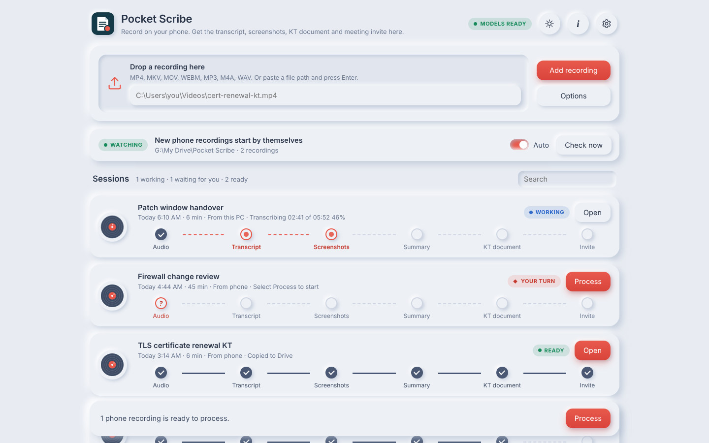

| Part | What it does |
|---|---|
| **Pill** (top right) | **MODELS READY**, **PICK MODELS**, **AI OFFLINE** or **NEEDS FFMPEG**. When something needs fixing, a banner under the header links to Settings |
| **Sun / moon** | Light or dark mode |
| **i** | How it works, what each output is, the step legend, privacy, shortcuts and this PC's setup |
| **Gear** | Settings |
| **Drop a recording here** | Drop a file, click **Add recording**, or paste a path and press Enter. A pasted path is used in place, so large files aren't copied |
| **Options** | Title, language, screenshot amount and words to know for the next recording you add |
| **Phone strip** | **WATCHING** when the Drive folder is found and **Auto** is on, **MANUAL** when Auto is off, **NO DRIVE** when the folder isn't found. **Check now** looks straight away |
| **Session cards** | One per recording, newest first, with the six-step rail and a status badge |

### The steps on each card

Every session moves along **Audio › Transcript › Screenshots › Summary › KT document › Invite**.

| Node | Meaning |
|---|---|
| Filled with a tick | Done |
| Red ring with a dot, dashed line | Working on it |
| **?** | Your turn: waiting for you to start it |
| Empty | Not yet |
| **!** | Stopped. Open the session to see why and retry |

Badges on the card: **WORKING**, **READY**, **YOUR TURN**, **SYNCING** (phone recording still arriving) and **STOPPED**. The record icon turns while work is running.

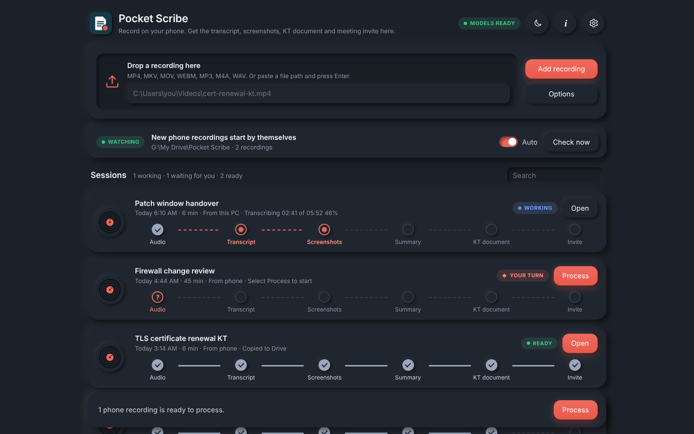

## Inside a session

Click a card to open it. The header has the title, details, the badge, **Export** and delete. The rail shows progress and a line on what's happening now. On the left: the video, **Capture frame**, **Follow** (the transcript follows the video) and the chapters.

### Overview

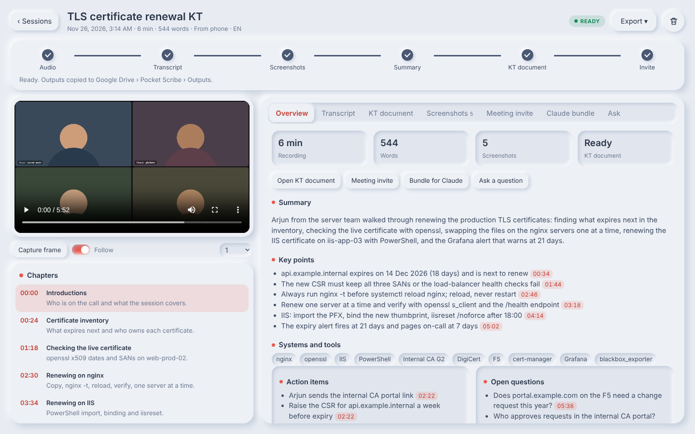

The summary, key points with `[mm:ss]` links, systems and tools, action items and open questions. Click any time to jump the video there.

### Transcript

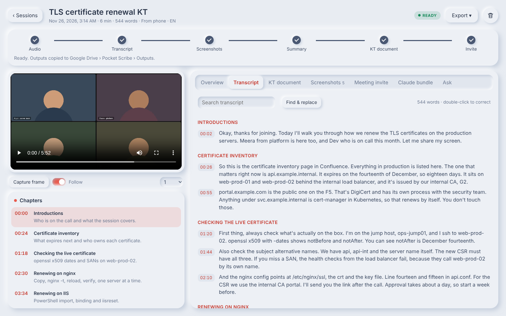

- Click a line to jump the video there.
- Double-click a line to correct it.
- **Find & replace** fixes a misheard word everywhere, for example *engine x* to *nginx*.
- Search with Enter for the next match, Shift+Enter for the previous one.

### Screenshots

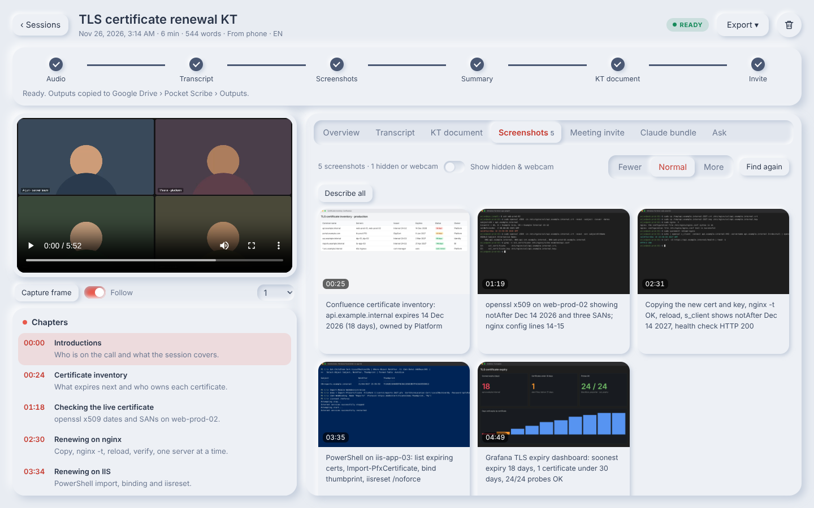

A screenshot is kept each time the shared screen changes. Each has a time and a description from the vision model.

- **Fewer / Normal / More** then **Find again** re-detects with a new sensitivity.
- **Describe all** asks the vision model again.
- On a screenshot: describe, edit the caption, hide or delete.
- **Show hidden & webcam** shows frames that only had faces in them. They're left out of the KT document and the bundle.
- **Capture frame** under the video adds any moment by hand.

### KT document

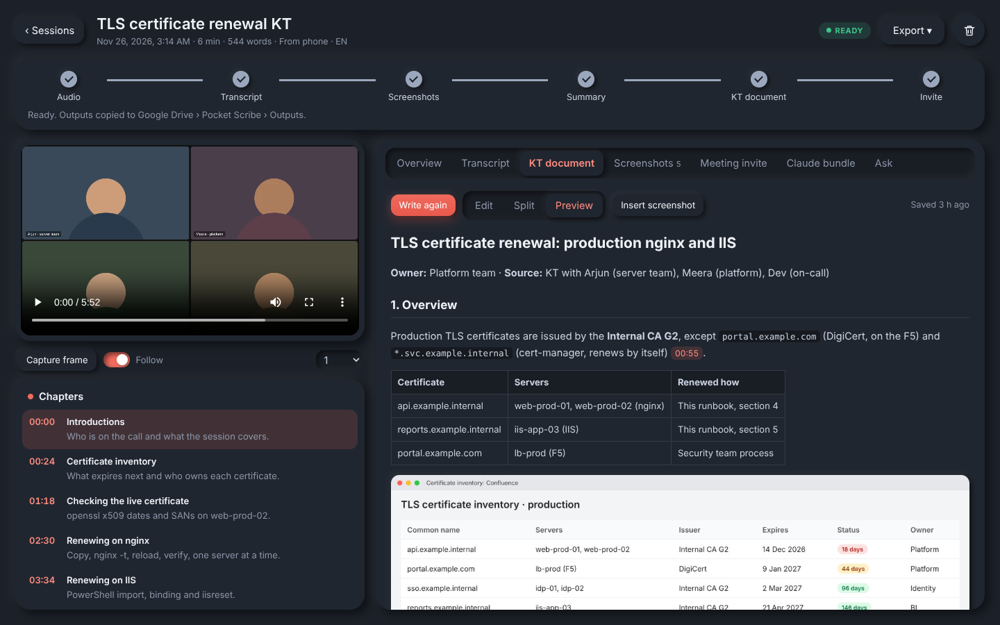

A step-by-step document written by the Writer model from the transcript and screenshots, following the outline in **Settings › Templates**.

- **Edit**, **Split** or **Preview**. Changes save as you type.
- **Insert screenshot** puts a frame where your cursor is.
- **Write again** opens a box for instructions, such as *"Audience is the on-call team. Focus on the rollback."* The earlier version is kept: **Previous version** swaps back.

### Meeting invite

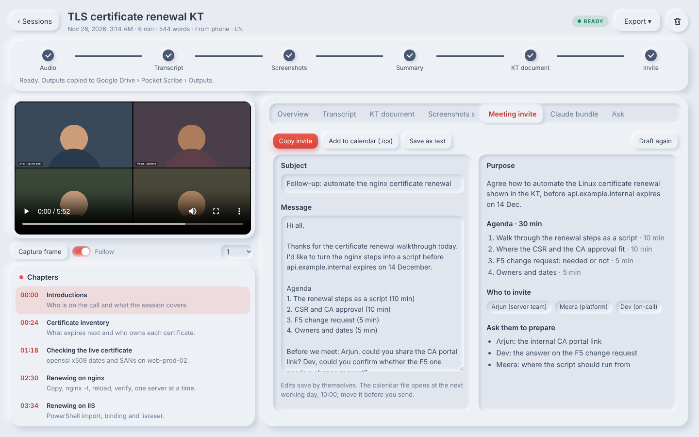

A follow-up meeting drafted from the open questions and action items: subject, purpose, agenda, attendees and prep. Edit the subject and body in place. **Copy invite**, download **.ics** for Outlook or **.txt**, or **Draft again**.

### Claude bundle

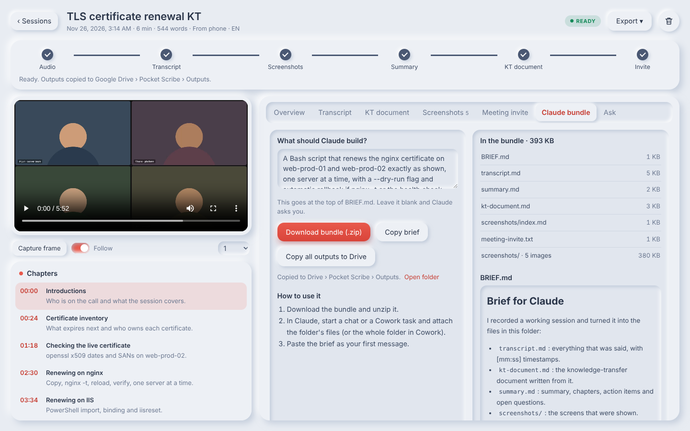

1. Type what Claude should build, for example *"A Bash script that renews the nginx certificate on both servers, one at a time, with a --dry-run flag."*
2. **Download bundle (.zip)**. It holds `BRIEF.md`, `transcript.md`, `summary.md`, `kt-document.md`, `screenshots/` with an `index.md`, and `meeting-invite.txt`.
3. In Claude, start a chat or a Cowork task, attach the files, and paste the brief as your first message. **Copy brief** copies it.

**Copy all outputs to Drive** writes the KT document (Word), the invite (.txt and .ics) and the bundle to **My Drive › Pocket Scribe › Outputs › date title**. **Open folder** opens it in File Explorer.

### Ask

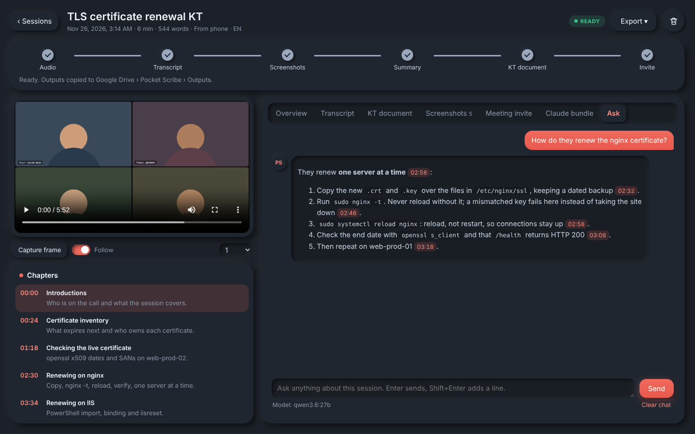

Ask anything about the session. Answers cite `[mm:ss]` so you can check them against the video. **Clear chat** starts over.

### Export

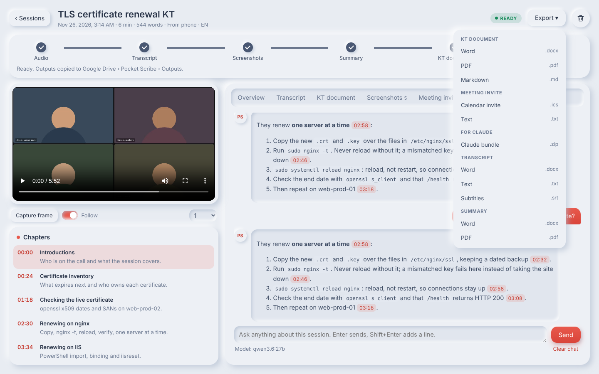

| Output | Formats |
|---|---|
| KT document | Word, PDF, Markdown |
| Meeting invite | Calendar invite (.ics), text |
| Claude bundle | .zip |
| Transcript | Word, text, subtitles (.srt) |
| Summary | Word, PDF |

## Use the outputs

| You want to | Do this |
|---|---|
| Hand over a KT document | Export Word, or open it from **Pocket Scribe › Outputs** in Drive |
| Book the follow-up | Download the **.ics** and open it in Outlook, or **Copy invite** into a new meeting |
| Automate what you saw | Claude bundle, with a clear goal |
| Check a detail | Ask, then click the time to watch that moment |
| Subtitle the recording | Export the transcript as .srt |

## Settings

Changes save as you make them; a small **Saved** note confirms it.

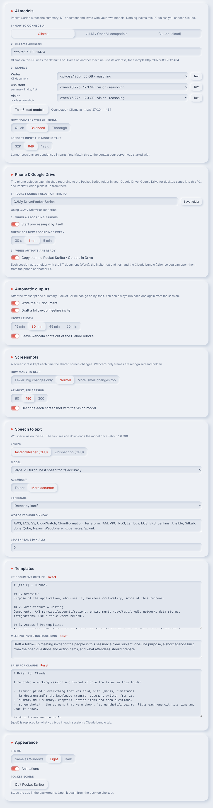

| Section | Setting | What it does |
|---|---|---|
| **AI models** | How to connect AI | **Ollama**, **vLLM / OpenAI-compatible** or **Claude (cloud)** |
| | Address, API key | Server address. Keys are encrypted with Windows and never shown again |
| | Writer, Assistant, Vision | Which model does what. **Test** checks each one |
| | How hard the writer thinks | Quick, Balanced or Thorough |
| | Longest input the models take | 32K, 64K or 128K. Longer sessions are condensed in parts first |
| **Phone & Google Drive** | Pocket Scribe folder on this PC | Found by itself, or paste it and **Save folder** |
| | Start processing it by itself | Auto-process new phone recordings |
| | Check for new recordings every | 30 s, 1 min or 5 min |
| | Copy them to Pocket Scribe › Outputs in Drive | Puts the outputs back in Drive when a session is ready |
| **Automatic outputs** | Write the KT document, Draft a follow-up meeting invite | Run these after the summary, or leave them for you to start |
| | Invite length | 15, 30, 45 or 60 minutes |
| | Leave webcam shots out of the Claude bundle | On by default |
| **Screenshots** | How many to keep | Fewer, Normal or More |
| | At most, per session | 60, 150 or 300 |
| | Describe each screenshot | Uses the Vision model |
| **Speech to text** | Engine | **faster-whisper** on the CPU, or **whisper.cpp** with a GPU build (set its exe and model paths) |
| | Model, Accuracy, Language | large-v3-turbo by default. Pick the language if you know it |
| | Words it should know | Product and server names Whisper should spell right |
| | CPU threads | 0 uses all cores |
| **Templates** | KT document outline | The sections the Writer follows. **Reset** restores the default |
| | Meeting invite instructions | How the invite is drafted |
| | Brief for Claude | The top of `BRIEF.md`. `{goal}` is replaced by what you type on the Claude bundle tab |
| **Appearance** | Theme | Same as Windows, Light or Dark |
| | Animations | Turn off for a still page |
| | Quit Pocket Scribe | Stops the app in the background. Open it again from the desktop shortcut |

## Troubleshooting

| What you see | What to do |
|---|---|
| Pill says **AI OFFLINE** | Start Ollama or your vLLM server. Check the address in Settings › AI models and click **Test & load models** |
| Pill says **PICK MODELS** | A role has no model. Pick one in Settings › AI models |
| Phone strip says **NO DRIVE** | Install and sign in to Google Drive for desktop. Paste `G:\My Drive\Pocket Scribe` in Settings › Phone & Google Drive and click **Save folder** |
| A phone recording doesn't appear | On the phone, check **Recordings** shows **ON DRIVE**. If it says **ON PHONE**, connect Drive or turn off **Back up on Wi-Fi only**. On the PC, check Drive for desktop has finished syncing |
| Card stays **SYNCING** | The file is still arriving. Large videos take a while on a slow upload |
| Phone can't connect to Drive | Check the Drive API is on, your account is a test user, the scope is `drive.file`, and the Android client has package `com.example.voicecam` and the SHA-1 from **Settings › Help › Google connection help** |
| Recording stops when the screen is off | Phone **Settings › Recording tips › Phone battery settings**, allow unrestricted battery use |
| Card shows **STOPPED** | Open it and click **Resume**. If a **CHECK** banner says a model step failed, fix the model and click **Try again** |
| Product names are spelled wrong | Add them to **Words it should know**, then **Find & replace** in this session |
| Too many or too few screenshots | Screenshots tab, pick **Fewer** or **More**, then **Find again** |
| The KT document takes a while to start | Large models load first; the status line shows it's thinking |
| Video doesn't play | The transcript and outputs still work. MP4 (H.264) plays everywhere |
| The app won't open | Run `start.bat` to see errors, and check `data\server.log` |
| Start over | Quit the app and delete the `data` folder |

**Where things are kept.** On the PC, everything is in `data\` next to the app: `data\sessions\<id>\` per session, `data\settings.json` for settings and `data\models\` for Whisper. In Drive, recordings are in **My Drive › Pocket Scribe** and outputs in **Pocket Scribe › Outputs**.
